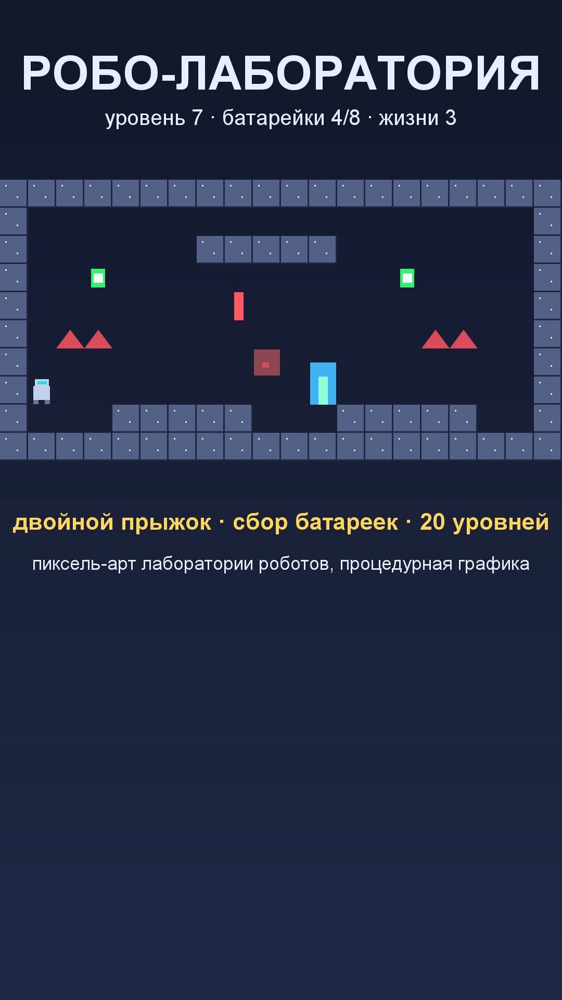

# Игра 01 — «Робо-Лаборатория» (RoboLab)

**Жанр:** 2D-платформер. **Кор-механика:** двойной прыжок, сбор батареек.
**Платформа:** Android 8.0+ (API 26+). **Стек:** Unity 6 (6000.5.6f1), C#, URP не используется — 2D Built-in.



## Сквозная тема портфолио ★
Игра про **робототехнику**: игрок — робот-испытатель в лаборатории роботов, собирающий
батарейки для энергоснабжения цеха. Уровни — «испытательные полигоны» с лазерами,
шипами и патрульными ботами.

## Механика
- Бег (A/D, стрелки или сенсорные зоны), **прыжок и двойной прыжок** (пробел/тап справа).
- Сбор батареек поднимает рейтинг уровня (3 звезды — все батарейки).
- Опасности: шипы, лазерные колонны, патрульные боты. Жизней 3 (на сложных уровнях 2).
- Выход из уровня — светящаяся дверь.
- 20 уровней, открытие следующего — по прохождению предыдущего; звёзды сохраняются.

## Контент: текстовые карты + рандомизация (ось уникальности C)
- 20 авторских карт в **текстовом формате** (символы: `# . S E ^ L P b`) — редактируются
  в любом текстовом редакторе, легко расширяются.
- Батарейки расставляются процедурно по сиду уровня (`seed = 104729 × level + 7919`),
  поэтому каждая попытка детерминирована, но позиции батареек не совпадают с авторской раскладкой.
- Вся графика — **процедурная пиксель-графика** (PixelSprites): текстуры робота, тайлов,
  батареек, шипов, лазеров, ботов рисуются кодом при запуске. Ни одного бинарного ассета.
- Звук — процедурный (синус-тоны AudioClip.Create).

## Управление (Android)
- Левая треть экрана — движение (край — влево, ближе к центру — вправо); правая часть — прыжок.
- Клавиатура (для отладки): A/D или ←/→, пробел/W/↑ — прыжок, Esc — пауза.

## Визуальная подпись

Пиксель-арт — единственная игра портфолио в этой эстетике: тёмно-синяя лаборатория роботов, неоново-зелёные батарейки, терминальный HUD.

Все 20 игр портфолио различаются по трём осям (жанр/механика, визуальный стиль/сеттинг, способ генерации контента); матрица уникальности — в корневом REGISTRY.md.

## Структура проекта
```
game-01-robolab/
├── src/Assets/Scripts/       # LevelMap, LevelCatalog (20 карт), LevelGenerator,
│                             # GameSession, ProgressState, PlayerController,
│                             # LevelBuilder, PixelSprites, GameBootstrap
├── src/Assets/Tests/EditMode # NUnit-тесты (написаны ДО реализации)
├── src/Assets/Editor/BuildScript.cs  # batchmode-сборка APK
├── src/Packages, src/ProjectSettings
├── assets-gen/ScreenshotGen.java     # генерация screenshot.png и иконки
├── artifacts/                # локально: APK + keystore
└── screenshot.png
```

## Тесты (16 шт., NUnit / Unity Test Framework, EditMode)
- `LevelMapTests` — размеры карт, наличие старта и выхода, стены по периметру,
  валидация кривых карт, детерминизм и непересечение батареек.
- `ProgressionTests` — звёзды за батарейки, счёт за скорость, жизни, уникальность 20 карт, правила открытия.

Запуск:
```powershell
powershell -ExecutionPolicy Bypass -File tools\test-unity.ps1 -GameDir game-01-robolab
```

## Сборка APK
```powershell
powershell -ExecutionPolicy Bypass -File tools\build-unity.ps1 -GameDir game-01-robolab `
    -AppId com.portfolio.robolab -ProductName "Робо-Лаборатория"
```
Unity batchmode (Mono-бэкенд, ARMv7+ARM64, minSdk 26), подпись release-ключом
(ключ генерируется автоматически в `artifacts/release.keystore`, пароль `android`).

## Готовая сборка
APK выкладываются в папку Google Диска портфолио:
https://drive.google.com/drive/folders/1YZzw1tn-sIxi9mlgxwU7H5XNdUKCMvw7?usp=sharing
(подпапка `game-01-robolab/`).
