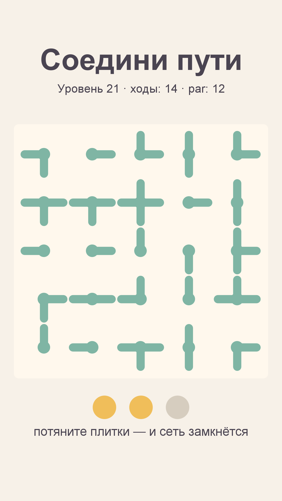

# Игра 02 — «Соедини пути» (PathLink)

**Жанр:** головоломка «соединение путей» (вращение плиток, pipe-rotation).
**Платформа:** Android 8.0+ (API 26+). **Стек:** Kotlin 2.0.21, Android SDK (Canvas), без внешних библиотек.



## Сквозная тема портфолио
Игра выполняет учебную задачу «минималистичный интерфейс головоломки»: чистая пастельная графика,
вся отрисовка — примитивы Canvas, весь звук — процедурный (синус-тоны AudioTrack), ни одного
стороннего ассета.

## Механика
- На поле N×N лежат плитки с трубами. Касание плитки поворачивает её на 90°.
- Цель: замкнуть всю сеть так, чтобы все клетки были соединены, а обрывов не осталось.
- Уровень пройден, когда путь от старта покрывает всё поле без «висящих» концов.
- Система звёзд: 3 звезды — за количество ходов не больше par, 2 — до 1.5×par, 1 — иначе.
- Подсказки: 3 на уровень, возвращают одну плитку в решение.
- Закреплённые плитки: с ростом сложности часть плиток зафиксирована в решении.

## Контент: как генерируются уровни (ось уникальности C)
Каждый из 60 уровней детерминированно генерируется по сиду:
1. На сетке строится **случайное остовное дерево** (рандомизированный DFS).
2. Из дерева получаются формы плиток (эталонное решённое состояние).
3. Плитки рандомизируются поворотами; par считается как сумма минимальных поворотов до решения.

Решение гарантированно существует — это порождающее состояние дерева. Размер поля растёт
с номером уровня: 4×4 (1–15), 5×5 (16–30), 6×6 (31–45), 7×7 (46–60).

## Прогрессия
- 60 уровней, открытие следующего уровня — по прохождению предыдущего.
- Звёзды и лучший результат хранятся в SharedPreferences (сериализация вида `уровень:звёзды:ходы`).
- Общий счётчик звёзд — в главном меню.

## Управление
- Тап по плитке — поворот на 90°.
- Кнопки: «←» — назад, «подсказка» — вернуть одну плитку, «Дальше» — следующий уровень.

## Структура проекта
```
game-02-pathlink/
├── src/AndroidManifest.xml        # манифест (portrait, fullscreen)
├── src/kotlin/com/pathlink/game/  # Board.kt (логика+генератор), Progress.kt,
│                                  # GameView.kt (Canvas UI), TonePlayer.kt (звук), MainActivity.kt
├── src/res/drawable/ic_launcher.png  # иконка (генерируется офлайн)
├── tests/pathlink/                # JUnit-тесты (написаны ДО реализации)
├── assets-gen/ScreenshotGen.kt    # генерация screenshot.png и иконки
├── artifacts/                     # локально: APK + keystore (в git не коммитится)
└── screenshot.png
```

## Тесты (18 шт., JUnit 4)
- `PathGeneratorTest` — решение всегда существует, детерминизм по сиду, par > 0.
- `SolverTest` — правила вращения, обнаружение обрывов и разобщённых групп, подсказки, счётчик ходов.
- `ProgressTest` — пороги звёзд, параметры уровней, сериализация прогресса, правила открытия.

Запуск:
```powershell
powershell -ExecutionPolicy Bypass -File tools\test-jvm.ps1 -GameDir game-02-pathlink
```

## Сборка APK
```powershell
powershell -ExecutionPolicy Bypass -File tools\build-javapk.ps1 -GameDir game-02-pathlink
```
Сборка выполняется без Gradle: `kotlinc` → `d8` → `aapt2` → `zipalign` → `apksigner`.
Результат: `artifacts/game-02-pathlink.apk`, ключ подписи — `artifacts/release.keystore`
(пароль `android`, для Google Play создайте собственный ключ).

## Готовая сборка
APK и скриншоты выкладываются в папку Google Диска портфолио:
https://drive.google.com/drive/folders/1YZzw1tn-sIxi9mlgxwU7H5XNdUKCMvw7?usp=sharing
(после заливки файлов они появятся в подпапке `game-02-pathlink/`).
