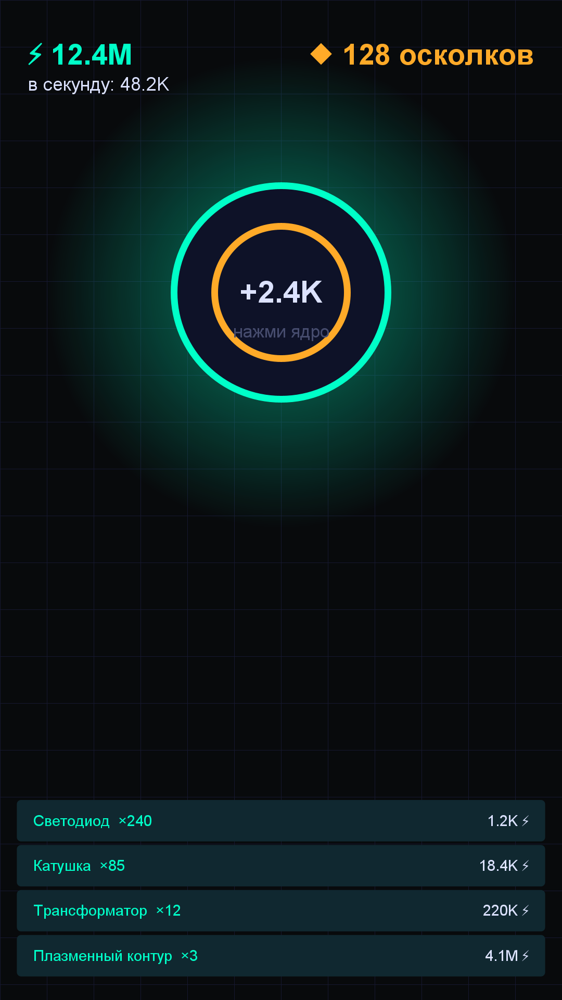

# Игра 03 — «Неоновое ядро» (Neon Core)

**Жанр:** idle / кликер с апгрейдами и престижем.
**Платформа:** Android 8.0+ (API 26+). **Стек:** Java 17, Android SDK (Canvas), без внешних библиотек.



## Механика
- **Клик по реактору** — выработка энергии (сила клика растёт от апгрейдов и осколков).
- **6 генераторов** (Светодиод → Неон-реактор) производят энергию автоматически; стоимость каждого
  следующего экземпляра растёт по геометрической прогрессии.
- **10 апгрейдов**: множители клика и генераторов, открываются по мере накопления энергии.
- **Престиж**: сброс прогресса в обмен на «осколки» — постоянный глобальный множитель (×5% за осколок).
- **Офлайн-прогресс**: при возвращении начисляется производство за время отсутствия (до 8 часов).
- **10 достижений** за вехи: энергия, число машин, апгрейды, престижи.

## Контент: генерация и баланс (ось уникальности C)
Кривая стоимости генераторов — параметрическая геометрическая прогрессия
(`стоимость = base × growth^level`, рост 1.15–1.19 в зависимости от генератора).
Кривая престижа — `осколки = ⌊√(totalEarned / 10^9)⌋`, что даёт плавное долгосрочное
целеполагание. Офлайн-прогресс — отдельная часть баланса с жёстким лимитом 8 часов,
чтобы не обесценивать активную игру.

## Управление
- Тап по реактору — выработка энергии.
- Вкладки «Генераторы» / «Апгрейды» / «Престиж» внизу экрана.
- Тап по строке — покупка; тап по кнопке престижа — сброс за осколки.

## Сохранение
Состояние сериализуется в SharedPreferences (`энергия|заработок|осколки|престиж|генераторы|апгрейды|достижения`)
при сворачивании приложения; при запуске начисляется офлайн-прогресс.

## Визуальная подпись

Фосфорный терминал: чёрный фон, связка циан+янтарь, светящиеся цифры — эстетика промышленных ЭВМ.

Все 20 игр портфолио различаются по трём осям (жанр/механика, визуальный стиль/сеттинг, способ генерации контента); матрица уникальности — в корневом REGISTRY.md.

## Структура проекта
```
game-03-neonidle/
├── src/AndroidManifest.xml
├── src/java/com/neonidle/game/   # Game.java (экономика, престиж, сохранение),
│                                 # GeneratorDef.java, NeonView.java (Canvas UI), Synth.java, MainActivity.java
├── src/res/drawable/ic_launcher.png
├── tests/neonidle/               # JUnit-тесты (написаны ДО реализации)
├── assets-gen/ScreenshotGen.java # генерация screenshot.png и иконки
├── artifacts/                    # локально: APK + keystore
└── screenshot.png
```

## Тесты (17 шт., JUnit 4)
- `EconomyTest` — геометрия цен, покупки, производство, сила клика, тик, формат чисел.
- `PrestigeTest` — формула осколков, сброс состояния, множитель от осколков.
- `OfflineSaveTest` — офлайн-начисление и его лимит, round-trip сохранения, достижения.

Запуск:
```powershell
powershell -ExecutionPolicy Bypass -File tools\test-jvm.ps1 -GameDir game-03-neonidle
```

## Сборка APK
```powershell
powershell -ExecutionPolicy Bypass -File tools\build-javapk.ps1 -GameDir game-03-neonidle
```
Конвейер без Gradle: `javac` → `d8` → `aapt2` → `zipalign` → `apksigner`.
Результат: `artifacts/game-03-neonidle.apk`.

## Готовая сборка
APK выкладываются в папку Google Диска портфолио:
https://drive.google.com/drive/folders/1YZzw1tn-sIxi9mlgxwU7H5XNdUKCMvw7?usp=sharing
(подпапка `game-03-neonidle/`).
