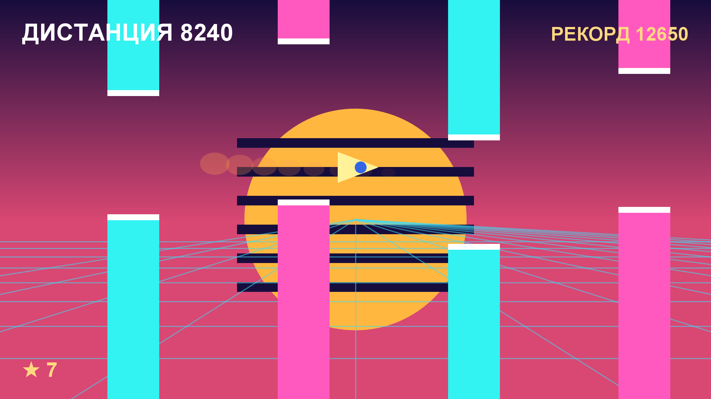

# Игра 04 — «Импульс-раннер» (Impulse Runner)

**Жанр:** аркада с управлением одной кнопкой.
**Платформа:** Android 8.0+ (API 26+). **Стек:** Godot 4.3 (GDScript), экспорт в APK через headless Godot.



## Механика
- Корабль летит вперёд автоматически; **одно касание (или пробел) — прыжок-импульс**.
- Единственная задача — уклоняться от неоновых барьеров с проходами.
- Скорость плавно растёт с дистанцией (от 320 до 900 ед/с).
- Столкновение — конец полёта: показывается дистанция, начисляются звёзды.
- Рекорд и звёзды сохраняются между запусками (ConfigFile в user://).

## Контент: грамматика препятствий (ось уникальности C)
Трасса генерируется комбинаторно: словарь из 6 типов паттернов
(`gap_low`, `gap_high`, `spikes`, `double_gap`, `mine`, `tunnel`), из которых
детерминированно (seed 20261028 + смещение) собирается последовательность.
Сложность управляет составом пула паттернов и высотой проходов, но **гарантия
проходимости** заложена в правилах: проход ≥ 150 ед., шаг между препятствиями
растёт с высотой прохода. Тесты проверяют и детерминизм, и проходимость.

## Управление
- Тап по экрану / пробел — прыжок (в меню — старт, после крушения — в меню).

## Структура проекта
```
game-04-onebutton/
├── src/project.godot          # настройки (landcape 1280x720, mobile renderer, ETC2/ASTC)
├── src/main.tscn, main.gd     # игровой цикл, физика, отрисовка (Canvas _draw)
├── src/logic/runner_logic.gd  # чистая логика: генератор, физика, скоринг
├── src/tests/                 # headless-тесты (написаны ДО реализации) + run_tests.gd
├── src/export_presets.cfg     # Android-пресет экспорта
├── src/icon.png               # иконка (генерируется офлайн)
├── assets-gen/ScreenshotGen.java  # генерация screenshot.png и иконки
├── artifacts/                 # локально: APK
└── screenshot.png
```

## Тесты (6 шт., headless GDScript)
- детерминизм генератора по сиду;
- проходимость проходов (минимальная высота, попадание в экран);
- дистанция между препятствиями (проходимость по X);
- монотонный рост скорости с пределом;
- детекция столкновений (внутри прохода / над плиткой / далеко по X);
- скоринг и лимит звёзд.

Запуск:
```powershell
powershell -ExecutionPolicy Bypass -File tools\test-godot.ps1 -GameDir game-04-onebutton
```

## Сборка APK
```powershell
powershell -ExecutionPolicy Bypass -File tools\build-godot.ps1 -GameDir game-04-onebutton
```
Headless-экспорт Godot с шаблонами 4.3.stable, подпись release-ключом.
Результат: `artifacts/game-04-onebutton.apk` (~43 МБ — движок + armv7/arm64).

## Готовая сборка
APK выкладываются в папку Google Диска портфолио:
https://drive.google.com/drive/folders/1YZzw1tn-sIxi9mlgxwU7H5XNdUKCMvw7?usp=sharing
(подпапка `game-04-onebutton/`).
