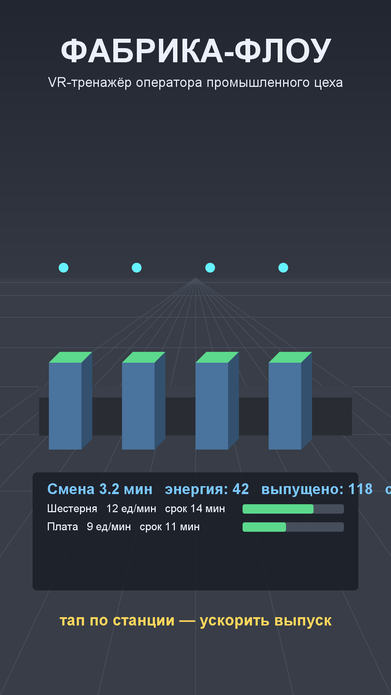

# Игра 05 — «Фабрика-Флоу» (FactoryFlow)

**Жанр:** симулятор распределения ресурсов. **Кор-механика:** балансировка производственной линии.
**Платформа:** Android 8.0+ (API 26+). **Стек:** Unity 6 (6000.5.6f1), C#, 3D Built-in (low-poly).



## Сквозная тема портфолио ★
**Промышленная автоматизация + VR**: игра оформлена как VR-тренажёр оператора цеха —
вид «от первого лица на пульт управления», заказы-наряды, энергобюджет, конвейер и станции.
Механика повторяет реальную задачу распределения ресурсов между участками линии.

## Механика
- Смена длится 6 «минут» (ускоренное время). Нужно выполнить заказы на выпуск.
- **Тап по станции** — инвестировать энергию и повысить её скорость (цена растёт с уровнем станции).
- Выпуск линии ограничен **узким местом** — самой медленной станцией (bottleneck).
- Энергия восстанавливается со временем: нужно распределять её между станциями.
- Заказы: продукт, темп (ед/мин), срок, приоритет; счёт = объём × соблюдение сроков.
- Уровни сложности: растёт число заказов и их темп; смена за сменой — всё сложнее.

## Контент: генератор сценариев (ось уникальности C)
Заказы смены генерируются по сиду и уровню сложности: количество заказов (2 + difficulty),
темп поставки (6 + 3×difficulty + случайность), сроки и приоритета (1–3). Генератор
детерминирован: один и тот же уровень всегда даёт одинаковый набор заказов.

## Управление (Android)
- Тап по 3D-станции в цеху — инвестировать энергию (raycast по нажатию).
- Кнопки HUD — переходы между сменами.

## Визуальная подпись

Единственная 3D-игра портфолио: low-poly цех с голографическими подсказками VR-тренажёра.

Все 20 игр портфолио различаются по трём осям (жанр/механика, визуальный стиль/сеттинг, способ генерации контента); матрица уникальности — в корневом REGISTRY.md.

## Структура проекта
```
game-05-factoryflow/
├── src/Assets/Scripts/       # ScenarioGenerator (заказы), ProductionLine (линия, bottleneck,
│                             # Fulfillment, FactorySim), GameBootstrap (3D-сцена и UI)
├── src/Assets/Tests/EditMode # NUnit-тесты (написаны ДО реализации)
├── src/Assets/Editor/        # BuildScript (batchmode-сборка APK)
├── assets-gen/ScreenshotGen.java
├── artifacts/                # локально: APK + keystore
└── screenshot.png
```

## Тесты (9 шт., NUnit / Unity Test Framework, EditMode)
- детерминизм генератора сценариев и рост числа заказов со сложностью;
- корректность параметров заказов;
- линейный рост выпуска от числа станций; bottleneck ограничивает пропускную способность;
- энергобюджет ограничивает добавление станций;
- счёт за соблюдение сроков и полноту поставки; симуляция смены накапливает выпуск.

Запуск:
```powershell
powershell -ExecutionPolicy Bypass -File tools\test-unity.ps1 -GameDir game-05-factoryflow
```

## Сборка APK
```powershell
powershell -ExecutionPolicy Bypass -File tools\build-unity.ps1 -GameDir game-05-factoryflow `
    -AppId com.portfolio.factoryflow -ProductName "FactoryFlow"
```

## Готовая сборка
APK выкладываются в папку Google Диска портфолио:
https://drive.google.com/drive/folders/1YZzw1tn-sIxi9mlgxwU7H5XNdUKCMvw7?usp=sharing
(подпапка `game-05-factoryflow/`).
