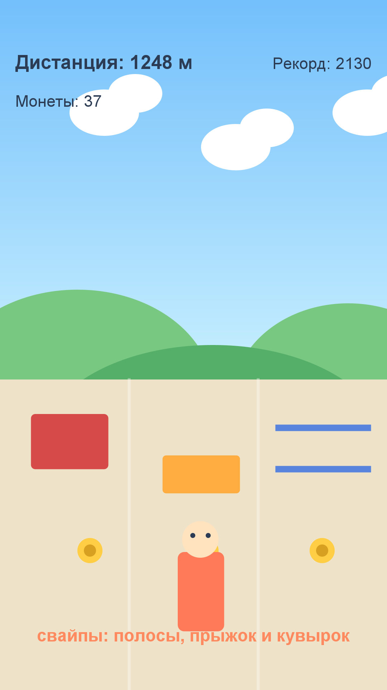

# Игра 06 — «Мультяшный раннер» (Cartoon Runner)

**Жанр:** бесконечный раннер. **Кор-механика:** свайпы (полосы, прыжок, кувырок), уклонение.
**Платформа:** Android 8.0+ (API 26+). **Стек:** Kotlin 2.0.21, Android SDK (Canvas).



## Механика
- Герон бежит по трассе автоматически; **свайпы**:
  - ◄ ► — перестроение между тремя полосами;
  - ▲ — прыжок (обходит высокие препятствия и берёт монеты вверху);
  - ▼ — кувырок (проходит под низкими барьерами).
- Препятствия: `x` стена (только сменить полосу), `h` высокое (прыжок), `l` низкое (кувырок),
  `b` монеты, `u` монеты в прыжке.
- Скорость растёт с дистанцией (до предела), очки = дистанция + монеты.
- 3 героя открываются по лучшей дистанции (2000 м и 5000 м); рекорд сохраняется.

## Контент: чанковая генерация (ось уникальности C)
Трасса собирается из **грамматики чанков** — 29 безопасных фрагментов
(`h.l.`, `b.x.`, `.bb.` и т.д.), детерминированно выбираемых по сиду.
Грамматика гарантирует проходимость: в чанках нет трёх стен подряд, трасса
заканчивается свободным отрезком. Тесты проверяют и грамматику, и отсутствие «xxx».

## Управление (Android)
- Свайпы по экрану; тап по кнопкам меню.

## Структура проекта
```
game-06-runner/
├── src/kotlin/com/runner/game/  # TrackGenerator (грамматика чанков), LaneState, RunRules,
│                                # RunnerView (Canvas UI), RunnerSound (синтез), MainActivity
├── src/AndroidManifest.xml
├── tests/runner/                # JUnit-тесты (написаны ДО реализации)
├── assets-gen/ScreenshotGen.java
├── artifacts/                   # локально: APK + keystore
└── screenshot.png
```

## Тесты (14 шт., JUnit 4)
- `TrackGeneratorTest` — детерминизм, разные сиды, безопасный хвост, чанки из грамматики, длина.
- `RunRulesTest` — ограничение полос, прыжок/кувырок, столкновения (x/h/l), скоринг, рост скорости, открытие героев.

Запуск:
```powershell
powershell -ExecutionPolicy Bypass -File tools\test-jvm.ps1 -GameDir game-06-runner
```

## Сборка APK
```powershell
powershell -ExecutionPolicy Bypass -File tools\build-javapk.ps1 -GameDir game-06-runner
```
Конвейер: `kotlinc` → `d8` → `aapt2` → `zipalign` → `apksigner`.
Результат: `artifacts/game-06-runner.apk`.

## Готовая сборка
APK выкладываются в папку Google Диска портфолио:
https://drive.google.com/drive/folders/1YZzw1tn-sIxi9mlgxwU7H5XNdUKCMvw7?usp=sharing
(подпапка `game-06-runner/`).
