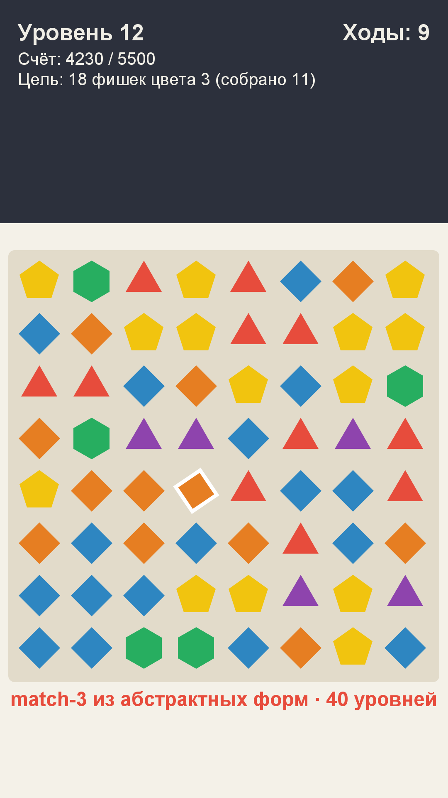

# Игра 07 — «Гео-Матч» (GeoMatch)

**Жанр:** match-3 (три в ряд). **Кор-механика:** обмен соседних плиток, каскады.
**Платформа:** Android 8.0+ (API 26+). **Стек:** Java 17, Android SDK (Canvas).



## Механика
- Доска 8×8 из геометрических форм (треугольники, квадраты, пяти- и шестиугольники, круги, ромбы).
- Тап по плитке → выбор; тап по соседней → обмен. Совпадение от 3 по горизонтали/вертикали.
- Каскады после падения множат очки; цепочка из 4+ даёт **спец-плитку** (бластер).
- Уровень: цель по счёту и сбору фишек определённого цвета, ограничение по ходам.
- 40 уровней: растущие цели, меньше ходов; звёзды за отношение счёта к цели.

## Контент: генератор доски с проверкой тупиков (ось уникальности C)
Стартовая доска генерируется по сиду уровня **без готовых совпадений** (раскатка случайных
цветов до чистого поля) и **без тупиков** — проверяется наличие хотя бы одного полезного
обмена; иначе генерация повторяется. Тесты проверяют оба свойства для 20 сидов.

## Управление (Android)
- Тап по плитке → тап по соседней: обмен. Кнопки меню и оверлеев.

## Визуальная подпись

Баухаус: чистая геометрия, первичные цвета, угловые модули-акценты.

Все 20 игр портфолио различаются по трём осям (жанр/механика, визуальный стиль/сеттинг, способ генерации контента); матрица уникальности — в корневом REGISTRY.md.

## Структура проекта
```
game-07-geomatch/
├── src/java/com/geomatch/game/  # MatchBoard (генерация, обмен, гравитация), MatchLogic (совпадения,
│                                # спец-плитки, скоринг), LevelCatalog, GameSession, MatchView, Sound
├── tests/geomatch/              # JUnit-тесты (написаны ДО реализации)
├── assets-gen/ScreenshotGen.java
├── artifacts/
└── screenshot.png
```

## Тесты (16 шт., JUnit 4)
- `BoardGeneratorTest` — отсутствие стартовых совпадений и тупиков, детерминизм, диапазон цветов,
  отклонение бессмысленных обменов, гравитация.
- `MatchRulesTest` — поиск горизонтальных/вертикальных цепочек, каскадный скоринг,
  пороги спец-плиток, рост сложности уровней, звёзды, расход ходов.

Запуск:
```powershell
powershell -ExecutionPolicy Bypass -File tools\test-jvm.ps1 -GameDir game-07-geomatch
```

## Сборка APK
```powershell
powershell -ExecutionPolicy Bypass -File tools\build-javapk.ps1 -GameDir game-07-geomatch
```

## Готовая сборка
APK выкладываются в папку Google Диска портфолио:
https://drive.google.com/drive/folders/1YZzw1tn-sIxi9mlgxwU7H5XNdUKCMvw7?usp=sharing
(подпапка `game-07-geomatch/`).
