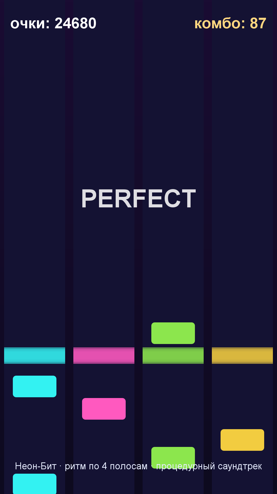

# Игра 08 — «Неон-Бит» (NeonBeat)

**Жанр:** ритм-игра (тапы в такт). **Платформа:** Android 8.0+ (API 26+).
**Стек:** Godot 4.3 (GDScript), процедурный синтез музыки (AudioStreamWAV).



## Механика
- Ноты падают по 4 полосам к линии попадания; тап по полосе в момент пересечения.
- Оценки: PERFECT (±55 мс), GOOD (±120 мс), MISS. Комбо растёт и множит очки.
- 10 треков с растущим BPM (96–172) и сложностью; итоговая оценка S/A/B/C по точности.
- Рекорды по трекам сохраняются между запусками.

## Контент: генератор дорожек + синтез (ось уникальности C)
- **Дорожки генерируются из BPM**: ритмическая грамматика (базовая доля, быстрые половинные
  ноты, паузы, двойные ноты на высокой сложности) детерминированно собирается по сиду трека.
- **Саундтрек синтезируется кодом** прямо в PCM16: кик-паттерн на каждую долю,
  хэт на восьмых, басовая линия по прогрессии. Ни одного аудиофайла.

## Управление (Android)
- Тап по четверти экрана — соответствующая полоса; клавиатура: D F J K.

## Структура проекта
```
game-08-neonbeat/
├── src/project.godot, main.tscn, main.gd   # игровой цикл, отрисовка, синтез музыки
├── src/logic/chart_generator.gd            # чистая логика: генератор, окна попаданий, скоринг
├── src/tests/                              # headless-тесты (написаны ДО реализации)
├── src/export_presets.cfg, src/icon.png
├── assets-gen/ScreenshotGen.java
├── artifacts/
└── screenshot.png
```

## Тесты (8 шт., headless GDScript)
детерминизм генератора, сортировка нот по времени, корректность полос, рост плотности
со сложностью, окна попаданий, рост очков от комбо и ноль за промах, оценки S/A/B/C, скорость нот.

Запуск:
```powershell
powershell -ExecutionPolicy Bypass -File tools\test-godot.ps1 -GameDir game-08-neonbeat
```

## Сборка APK
```powershell
powershell -ExecutionPolicy Bypass -File tools\build-godot.ps1 -GameDir game-08-neonbeat
```
Результат: `artifacts/game-08-neonbeat.apk` (~43 МБ).

## Готовая сборка
APK выкладываются в папку Google Диска портфолио:
https://drive.google.com/drive/folders/1YZzw1tn-sIxi9mlgxwU7H5XNdUKCMvw7?usp=sharing
(подпапка `game-08-neonbeat/`).
