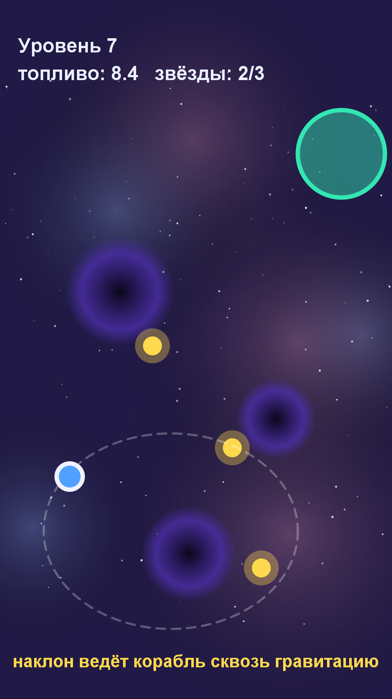

# Игра 09 — «Гравити-Дрифт» (GravityDrift)

**Жанр:** физическая головоломка. **Кор-механика:** управление наклоном телефона.
**Платформа:** Android 8.0+ (API 26+). **Стек:** Unity 6 (6000.5.6f1), C#, 2D-физика.



## Механика
- Корабль дрейфует в космосе; **наклон телефона** создаёт тягу (для эмулятора — тач-драг).
- На трассе — **гравитационные колодцы**: они притягивают корабль (обратные квадраты).
- Цель: добраться до стыковочного порта, собрав по пути звёзды.
- Топливо тратится только на управление: чем меньше тяги — тем выше бонус.
- 30 уровней: число и масса колодцев растут; звёзды и очки сохраняются.

## Контент: параметрические гравитационные колодцы (ось уникальности C)
Уровни генерируются из сида: число колодцев (1 + уровень/2), массы (40–160 + 6×уровень),
позиции в границах поля; старт и цель — у противоположных краёв, колодцы выталкиваются
из безопасной зоны цели. Запас топлива масштабируется с уровнем.

## Управление (Android)
- Наклон устройства — вектор тяги. Тач-драг — запасной вариант (эмулятор/отладка).

## Визуальная подпись

Акварельная туманность: мягкие розово-голубые пятна на индиго, крупные мазки.

Все 20 игр портфолио различаются по трём осям (жанр/механика, визуальный стиль/сеттинг, способ генерации контента); матрица уникальности — в корневом REGISTRY.md.

## Структура проекта
```
game-09-gravity/
├── src/Assets/Scripts/       # GravityCore (LevelGenerator, PhysicsMath), GameBootstrap (сцена, UI)
├── src/Assets/Tests/EditMode # NUnit-тесты (написаны ДО реализации)
├── src/Assets/Editor/        # BuildScript (batchmode-сборка APK)
├── assets-gen/ScreenshotGen.java
├── artifacts/
└── screenshot.png
```

## Тесты (9 шт., NUnit / Unity Test Framework, EditMode)
детерминизм генератора, рост числа колодцев с уровнем, границы поля, разнесение старта и цели,
безопасная зона цели, обратные квадраты гравитации, направление силы, топливный бюджет, скоринг.

Запуск:
```powershell
powershell -ExecutionPolicy Bypass -File tools\test-unity.ps1 -GameDir game-09-gravity
```

## Сборка APK
```powershell
powershell -ExecutionPolicy Bypass -File tools\build-unity.ps1 -GameDir game-09-gravity `
    -AppId com.portfolio.gravitydrift -ProductName "GravityDrift"
```

## Готовая сборка
APK выкладываются в папку Google Диска портфолио:
https://drive.google.com/drive/folders/1YZzw1tn-sIxi9mlgxwU7H5XNdUKCMvw7?usp=sharing
(подпапка `game-09-gravity/`).
