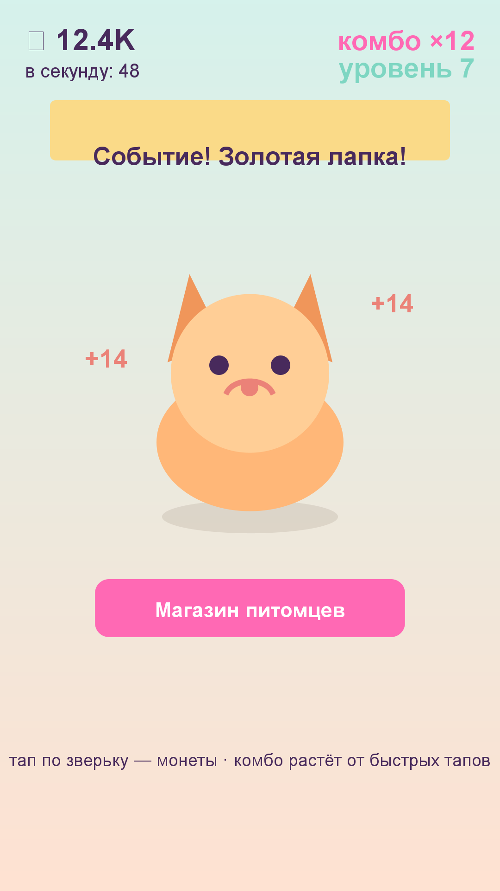

# Игра 10 — «Пушистый кликер» (Pet Clicker)

**Жанр:** кликер. **Кор-механика:** тапы по объекту, комбо-цепочки.
**Платформа:** Android 8.0+ (API 26+). **Стек:** Java 17, Android SDK (Canvas).



## Механика
- **Тап по зверьку** — монеты; быстрые тапы наращивают **комбо** (множитель награды,
  сбрасывается через 1.5 с бездействия).
- **8 питомцев** (котёнок → дракончик) производят монеты автоматически; цена каждого
  следующего растёт на 15%; питомцы открываются по уровню игрока (1 + 2×индекс).
- **Ивенты**: Золотая лапка, Радужный мячик, Сладкий сон, Валежник вкусняшек —
  выпадают по времени и дают бонусы (тап по баннеру — забрать).
- Магазин питомцев, сохранение прогресса, уровни игрока.

## Контент: ивент-спавнер и цепочки комбо (ось уникальности C)
Серия ивентов генерируется детерминированно по сиду: интервалы 8–22 с, типы ивентов
выбираются по весам, с гарантией «золотой лапки» в каждой серии. Экономика комбо —
отдельная кривая: +0.25 к награде за тап за каждое звено цепочки.

## Управление (Android)
- Тап по зверьку — монеты; тап по баннеру ивента — награда; кнопки меню и магазина.

## Визуальная подпись

Наклейки: яркий мятный фон, толстые белые контуры фигурок, глянцевые блики.

Все 20 игр портфолио различаются по трём осям (жанр/механика, визуальный стиль/сеттинг, способ генерации контента); матрица уникальности — в корневом REGISTRY.md.

## Структура проекта
```
game-10-petclicker/
├── src/java/com/petclicker/game/  # PetGame (экономика, комбо, сохранение), EventSpawner,
│                                  # PetView (Canvas UI), PetSound, MainActivity
├── tests/petclicker/              # JUnit-тесты (написаны ДО реализации)
├── assets-gen/ScreenshotGen.java
├── artifacts/
└── screenshot.png
```

## Тесты (11 шт., JUnit 4)
тап даёт монеты; комбо множит награду и сбрасывается по таймауту; питомцы производят
автоматически; цена растёт; покупка требует монет; ивенты детерминированы и содержат
золотую лапку; лапка даёт бонус; round-trip сохранения; открытие питомцев по уровню.

Запуск:
```powershell
powershell -ExecutionPolicy Bypass -File tools\test-jvm.ps1 -GameDir game-10-petclicker
```

## Сборка APK
```powershell
powershell -ExecutionPolicy Bypass -File tools\build-javapk.ps1 -GameDir game-10-petclicker
```

## Готовая сборка
APK выкладываются в папку Google Диска портфолио:
https://drive.google.com/drive/folders/1YZzw1tn-sIxi9mlgxwU7H5XNdUKCMvw7?usp=sharing
(подпапка `game-10-petclicker/`).
