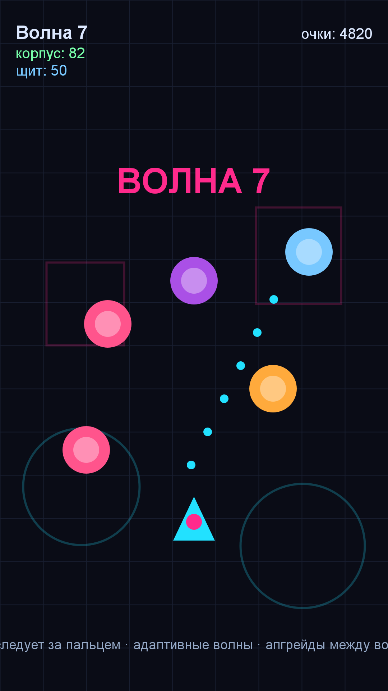

# Игра 11 — «Дрон-Патруль» (Drone Patrol)

**Жанр:** шутер сверху. **Кор-механика:** управление дроном, автострельба.
**Платформа:** Android 8.0+ (API 26+). **Стек:** Kotlin 2.0.21, Android SDK (Canvas).



## Сквозная тема портфолио ★
**Робототехника**: игрок — оператор патрульного дрона на автоматизированном автозаводе.
Киберпанк-визуализация: неоновая сетка цеха, очертания оборудования, волны сбоев-врагов.

## Механика
- Дрон **следует за пальцем**; огонь ведётся автоматически по ближайшей цели.
- Враги типов: Разведчик, Спринтер, Танк, Турель; каждая 5-я волна — **босс**.
- Между волнами — выбор улучшения: щит, урон, скорострельность.
- Корпус, щит, очки; лучшая волна сохраняется.

## Контент: адаптивный «режиссёр волн» (ось уникальности C)
Состав и крепость волн генерируются по сиду и **метрике производительности игрока**
(состояние корпуса и щита): сильный игрок получает более плотные и крепкие волны,
слабый — фору. Метрика ограничена диапазоном 0.5–1.5, чтобы адаптация не ломала баланс.

## Управление (Android)
- Драг по экрану — движение дрона; огонь автоматический.

## Структура проекта
```
game-11-drone/
├── src/kotlin/com/drone/game/  # CombatCore (WaveDirector, CombatMath, DroneState),
│                               # DroneView (Canvas UI), DroneSound, MainActivity
├── tests/drone/                # JUnit-тесты (написаны ДО реализации)
├── assets-gen/ScreenshotGen.java
├── artifacts/
└── screenshot.png
```

## Тесты (14 шт., JUnit 4)
детерминизм волн; рост числа врагов; адаптация к производительности игрока; типы врагов;
босс на каждой 5-й волне; ограничение метрики; броня и урон; лимит темпа огня;
попадания по радиусу; поглощение урона щитом; рост цены апгрейдов; апгрейд урона; скоринг.

Запуск:
```powershell
powershell -ExecutionPolicy Bypass -File tools\test-jvm.ps1 -GameDir game-11-drone
```

## Сборка APK
```powershell
powershell -ExecutionPolicy Bypass -File tools\build-javapk.ps1 -GameDir game-11-drone
```

## Готовая сборка
APK выкладываются в папку Google Диска портфолио:
https://drive.google.com/drive/folders/1YZzw1tn-sIxi9mlgxwU7H5XNdUKCMvw7?usp=sharing
(подпапка `game-11-drone/`).
