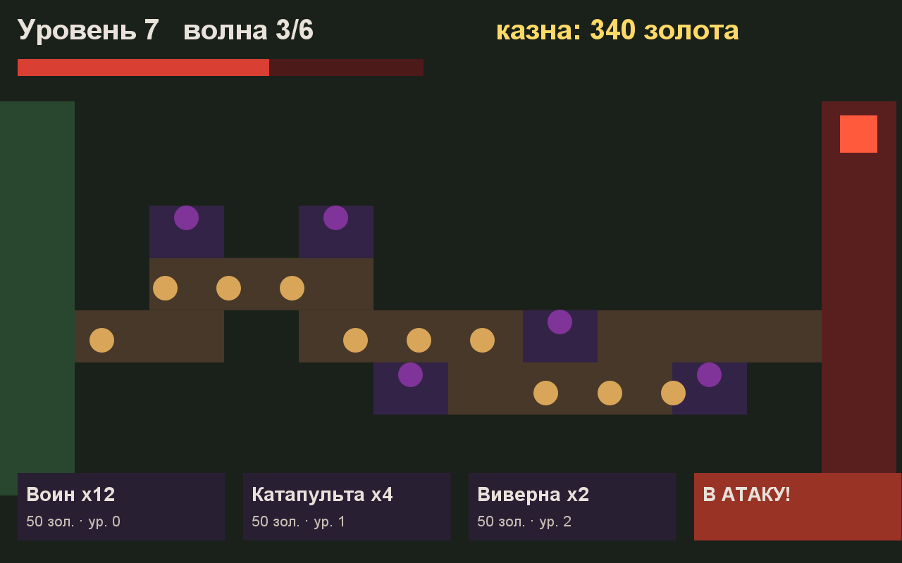

# Игра 12 — «Тёмная осада» (Dark Siege)

**Жанр:** tower defense с **инверсией ролей** — игрок атакует, крепость защищается.
**Платформа:** Android 8.0+ (API 26+). **Стек:** Godot 4.3 (GDScript).



## Механика
- Игрок — атакующая сторона: набирает **колонну войск** (Воин, Катапульта, Виверна)
  и штурмует крепость тёмного королевства.
- Защитник расставляет башни вдоль пути — они срезают отряд на марше.
- Между волнами: найм войск за золото и **улучшения** (урон растёт с уровнем).
- Прочность крепости убывает от доживших до цели юнитов; волн ограничено — нужно успеть.
- 20 уровней: больше и сильнее башен; звёзды за скорость (3 — за 3 волны и меньше).

## Контент: процедурная карта + пазл расстановки (ось уникальности C)
Карта осады генерируется по сиду: путь змейкой от лагеря к крепости, башни — **рядом с
путём, но не на нём** (проверка в тестах). Бой волны считается **детерминированной
симуляцией**: экспозиция каждой башни пропорциональна её радиусу, выжившие юниты
наносят урон крепости. Сложность масштабирует число и урон башен.

## Управление (Android)
- Тап по карточкам юнитов внизу — найм; тап по колонке юнита сверху — улучшение.
- Кнопка «В АТАКУ!» — запуск волны.

## Структура проекта
```
game-12-siege/
├── src/project.godot, main.tscn, main.gd  # карта, найм, волны, отрисовка
├── src/logic/siege_logic.gd               # чистая логика: карта, симуляция боя, улучшения
├── src/tests/                             # headless-тесты (написаны ДО реализации)
├── src/export_presets.cfg, src/icon.png
├── assets-gen/ScreenshotGen.java
├── artifacts/
└── screenshot.png
```

## Тесты (9 шт., headless GDScript)
детерминизм карты; связность пути «лагерь → крепость»; башни не на пути; рост числа башен
со сложностью; детерминированная симуляция волны; больше армия — больше урона;
кламп прочности крепости; стоимость и множитель улучшений; звёзды за волны.

Запуск:
```powershell
powershell -ExecutionPolicy Bypass -File tools\test-godot.ps1 -GameDir game-12-siege
```

## Сборка APK
```powershell
powershell -ExecutionPolicy Bypass -File tools\build-godot.ps1 -GameDir game-12-siege
```

## Готовая сборка
APK выкладываются в папку Google Диска портфолио:
https://drive.google.com/drive/folders/1YZzw1tn-sIxi9mlgxwU7H5XNdUKCMvw7?usp=sharing
(подпапка `game-12-siege/`).
