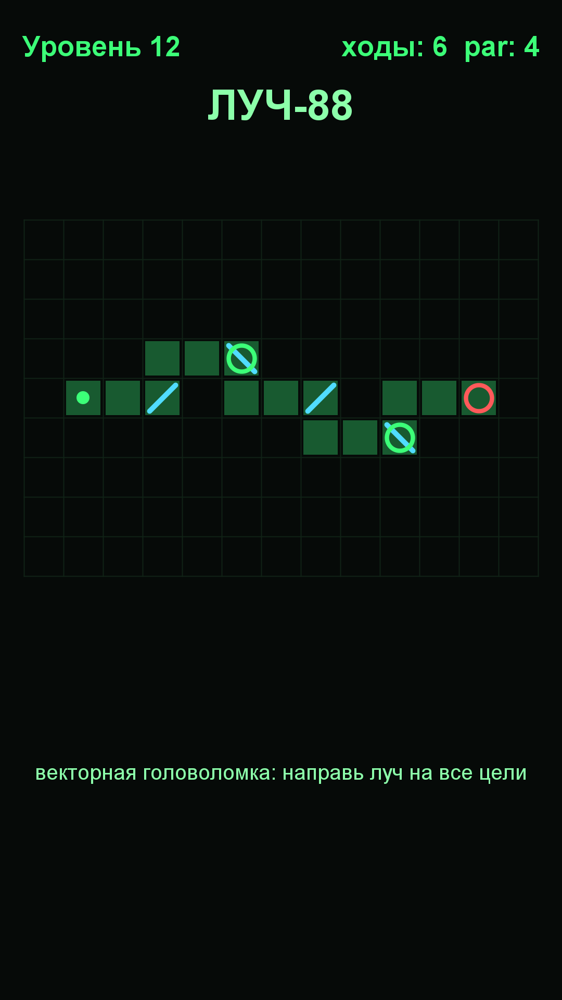

# Игра 13 — «Луч-88» (LaserGrid)

**Жанр:** головоломка «освещение пути». **Кор-механика:** вращение зеркал, направление луча.
**Платформа:** Android 8.0+ (API 26+). **Стек:** Java 17, Android SDK (Canvas).



## Механика
- Луч выходит из источника и движется по сетке; **зеркала `/` и `\`** разворачивают его.
- Цель: повернуть зеркала так, чтобы луч осветил **все цели** на поле.
- Стены блокируют луч; луч проходит сквозь цели, освещая их.
- 40 уровней: число зеркал и целей растёт; звёзды за ходы (3 — не больше par).

## Контент: solution-first генератор (ось уникальности C)
Уровень строится **от решения**: сначала прокладывается самоизбегающий маршрут луча,
на котором детерминированно (шахматный порядок через клетку) расставляются зеркала
и цели — решение гарантировано существует. Затем зеркала перемешиваются (с гарантией,
что стартовая позиция нерешаема). Тесты проверяют решаемость эталона и нерешаемость старта.

## Управление (Android)
- Тап по зеркалу — поворот на 90°.

## Структура проекта
```
game-13-lasergrid/
├── src/java/com/lasergrid/game/  # BeamLogic (трассировка луча), LevelGenerator (solution-first),
│                                 # PuzzleState, LaserView (Canvas UI), MainActivity
├── tests/lasergrid/              # JUnit-тесты (написаны ДО реализации)
├── assets-gen/ScreenshotGen.java
├── artifacts/
└── screenshot.png
```

## Тесты (13 шт., JUnit 4)
- `BeamLogicTest` — прямой луч, отражения от `/` и `\`, блокировка стенами, все цели освещены, нет источника.
- `LevelGeneratorTest` — эталон всегда решаем, детерминизм, старт нерешён, рост сложности,
  par > 0, поворот меняет состояние, звёзды.

Запуск:
```powershell
powershell -ExecutionPolicy Bypass -File tools\test-jvm.ps1 -GameDir game-13-lasergrid
```

## Сборка APK
```powershell
powershell -ExecutionPolicy Bypass -File tools\build-javapk.ps1 -GameDir game-13-lasergrid
```

## Готовая сборка
APK выкладываются в папку Google Диска портфолио:
https://drive.google.com/drive/folders/1YZzw1tn-sIxi9mlgxwU7H5XNdUKCMvw7?usp=sharing
(подпапка `game-13-lasergrid/`).
