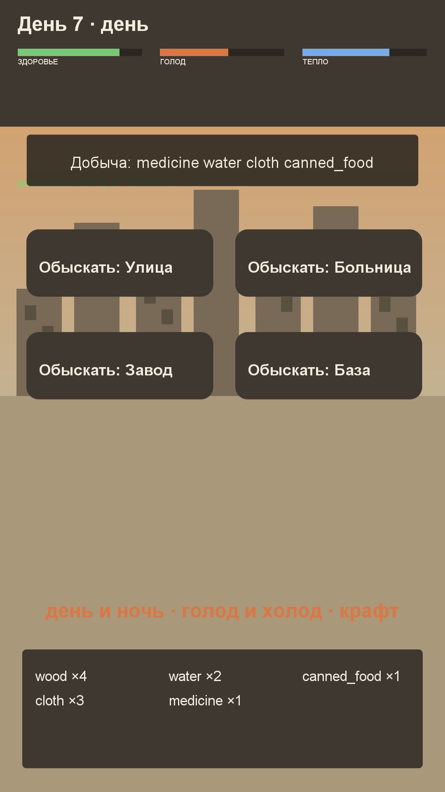

# Игра 14 — «Пепел» (Wasteland)

**Жанр:** выживание. **Кор-механика:** ограниченные ресурсы, поиск, крафт.
**Платформа:** Android 8.0+ (API 26+). **Стек:** Kotlin 2.0.21, Android SDK (Canvas).



## Механика
- **Цикл дня и ночи**: каждые 3 действия сменяются день/ночь; ночью холоднее, голод растёт всегда.
- **Три шкалы**: здоровье, голод, тепло. Крайние значения (голод 100%, тепло 0%) бьют по здоровью.
- **Обыск 4 локаций**: Улица, Больница, Завод, Военная база — у каждой своя лут-таблица.
- **Крафт**: 7 рецептов (костёр, бинт, чистая вода, похлёбка, тёплая куртка, генератор, оружие),
  включая рецепты из созданных предметов (похлёбка требует костёр).
- Действия: еда (консервы), костёр (3 дров), отдых. Цель — прожить как можно больше дней.

## Контент: лут-таблицы + крафт-дерево (ось уникальности C)
Добыча генерируется детерминированно по сиду, локации и дню: редкие локации
(база, завод) дают более ценный лут, с днями добыча растёт. Крафт-дерево проверяется
на отсутствие циклов — рецепты образуют направленный ациклический граф.

## Управление (Android)
- Тапы по карточкам локаций, кнопкам крафта, еды, костра, отдыха.

## Визуальная подпись

Пыльная пустошь: выцветшие тона и зелёная шкала радиационного фона.

Все 20 игр портфолио различаются по трём осям (жанр/механика, визуальный стиль/сеттинг, способ генерации контента); матрица уникальности — в корневом REGISTRY.md.

## Структура проекта
```
game-14-wasteland/
├── src/kotlin/com/wasteland/game/  # LootTable (лут-таблицы), CraftingBook (рецепты),
│                                   # SurvivalState (шкалы, день/ночь), WastelandView, MainActivity
├── tests/wasteland/                # JUnit-тесты (написаны ДО реализации)
├── assets-gen/ScreenshotGen.java
├── artifacts/
└── screenshot.png
```

## Тесты (11 шт., JUnit 4)
детерминизм лута; редкие локации богаче; известность предметов; ингредиенты рецептов;
отсутствие циклов в крафт-дереве; списание ресурсов при крафте; рост голода и падение тепла;
ночь холоднее дня; голод бьёт по здоровью; еда восстанавливает голод; рост очков с днями.

Запуск:
```powershell
powershell -ExecutionPolicy Bypass -File tools\test-jvm.ps1 -GameDir game-14-wasteland
```

## Сборка APK
```powershell
powershell -ExecutionPolicy Bypass -File tools\build-javapk.ps1 -GameDir game-14-wasteland
```

## Готовая сборка
APK выкладываются в папку Google Диска портфолио:
https://drive.google.com/drive/folders/1YZzw1tn-sIxi9mlgxwU7H5XNdUKCMvw7?usp=sharing
(подпапка `game-14-wasteland/`).
