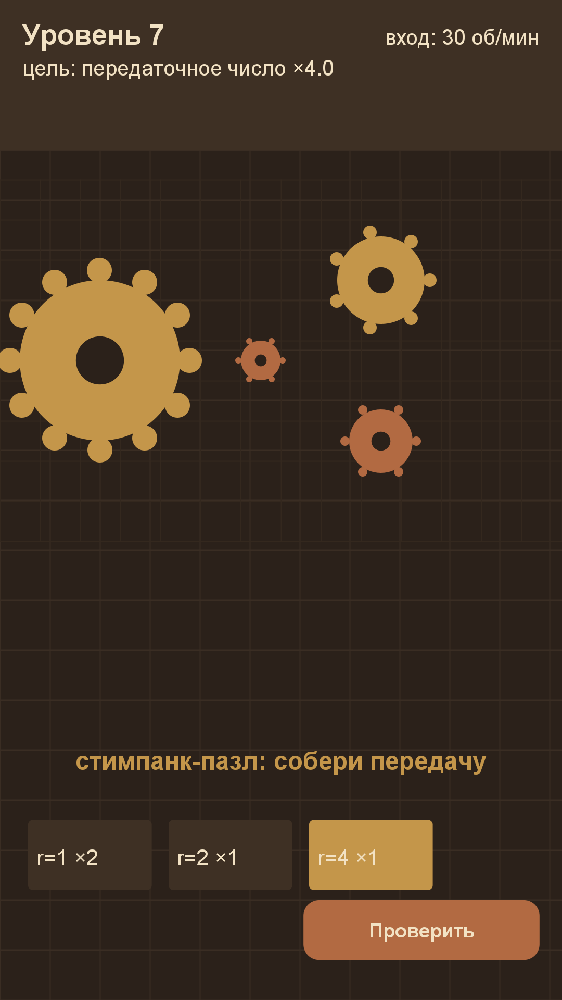

# Игра 15 — «Механозавр» (GearWorks)

**Жанр:** пазл сборки механизма. **Кор-механика:** зубчатые передачи, передаточные числа.
**Платформа:** Android 8.0+ (API 26+). **Стек:** Java 17, Android SDK (Canvas).



## Механика
- На «столе» нужно выложить **шестерни** из инвентаря так, чтобы выход вращался
  с **целевым передаточным числом** (отношение радиусов вдоль цепи).
- Шестерни сцепляются, если расстояние между центрами равно сумме радиусов;
  каждое сцепление меняет направление вращения.
- Проверка: цепь от входной оси до выходной даёт нужное число — уровень пройден.
- 40 уровней: целевое число растёт (×2 … ×8); звёзды за число ходов.

## Контент: параметрические шаблоны передач (ось уникальности C)
Уровни строятся из параметрического шаблона: эталонная пара «ведущая r=N → ведомая r=1»
гарантирует целевое передаточное число, инвентарь пополняется отвлекающими шестернями.
Тесты проверяют и решаемость эталона, и достаточность инвентаря.

## Управление (Android)
- Тап по шестерне в инвентаре — выбор радиуса; тап по клетке — установка.
- «Проверить» — оценка сборки; «Сброс» — начать уровень заново.

## Визуальная подпись

Патентный чертёж: латунные детали на бумаге со штриховкой, как в заявке на изобретение.

Все 20 игр портфолио различаются по трём осям (жанр/механика, визуальный стиль/сеттинг, способ генерации контента); матрица уникальности — в корневом REGISTRY.md.

## Структура проекта
```
game-15-gearworks/
├── src/java/com/mechanosaur/game/  # Gear, GearSystem (сцепление, передаточные числа),
│                                   # LevelGenerator, GearView, MainActivity
├── tests/mechanosaur/              # JUnit-тесты (написаны ДО реализации)
├── assets-gen/ScreenshotGen.java
├── artifacts/
└── screenshot.png
```

## Тесты (13 шт., JUnit 4)
- `GearSystemTest` — сцепление по расстоянию, отсутствие сцепления вдали, чередование
  направлений, передаточное число, связность цепи, отказ занятой клетки, обороты выхода.
- `GearLevelTest` — эталон решает уровень, детерминизм, рост сложности, достаточность
  инвентаря, par > 0, эталон даёт целевое число.

Запуск:
```powershell
powershell -ExecutionPolicy Bypass -File tools\test-jvm.ps1 -GameDir game-15-gearworks
```

## Сборка APK
```powershell
powershell -ExecutionPolicy Bypass -File tools\build-javapk.ps1 -GameDir game-15-gearworks
```

## Готовая сборка
APK выкладываются в папку Google Диска портфолио:
https://drive.google.com/drive/folders/1YZzw1tn-sIxi9mlgxwU7H5XNdUKCMvw7?usp=sharing
(подпапка `game-15-gearworks/`).
