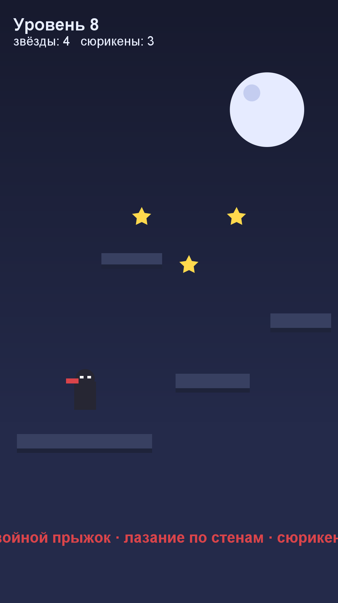

# Игра 16 — «Тень-Клинок» (ShadowBlade)

**Жанр:** 2D-платформер. **Кор-механика:** двойной прыжок, лазание по стенам, сюрикены.
**Платформа:** Android 8.0+ (API 26+). **Стек:** Unity 6 (6000.5.6f1), C#.



## Механика
- Ниндзя бежит по ночному городу: **двойной прыжок**, отскоки от стен, бросок сюрикена.
- Собирай звёзды (влияют на рейтинг уровня), уворачивайся от пропастей.
- 25 уровней: длина и высота препятствий растут; звёзды и лучший результат сохраняются.

## Контент: чанковый генератор с гарантией проходимости (ось уникальности C)
Уровни собираются из **чанков грамматики** (ровная площадка, прыжок через пропасть,
ступени, лазание по стене, опасные ямы, звёздный маршрут) — каждый чанк проходим
двойным прыжком и лазанием; стыки чанков безопасны. Тесты проверяют принадлежность
чанков грамматике и проходимость для 15 сидов.

## Управление (Android)
- A/D или стрелки — движение; пробел — прыжок (дважды — двойной); X — сюрикен.

## Структура проекта
```
game-16-ninja/
├── src/Assets/Scripts/       # NinjaCore (LevelChunkGenerator, PhysicsKit, NinjaSession),
│                             # NinjaGame (сцена, NinjaController), спрайты генерируются кодом
├── src/Assets/Tests/EditMode # NUnit-тесты (написаны ДО реализации)
├── src/Assets/Editor/        # BuildScript (batchmode-сборка APK)
├── assets-gen/ScreenshotGen.java
├── artifacts/
└── screenshot.png
```

## Тесты (10 шт., NUnit / Unity Test Framework, EditMode)
детерминизм генератора; чанки из грамматики; проходимость уровней; длина по запросу;
ровный старт; звёзды за сбор; высота двойного прыжка; лимит сюрикенов; скоринг.

Запуск:
```powershell
powershell -ExecutionPolicy Bypass -File tools\test-unity.ps1 -GameDir game-16-ninja
```

## Сборка APK
```powershell
powershell -ExecutionPolicy Bypass -File tools\build-unity.ps1 -GameDir game-16-ninja `
    -AppId com.portfolio.shadowblade -ProductName "ShadowBlade"
```

## Готовая сборка
APK выкладываются в папку Google Диска портфолио:
https://drive.google.com/drive/folders/1YZzw1tn-sIxi9mlgxwU7H5XNdUKCMvw7?usp=sharing
(подпапка `game-16-ninja/`).
