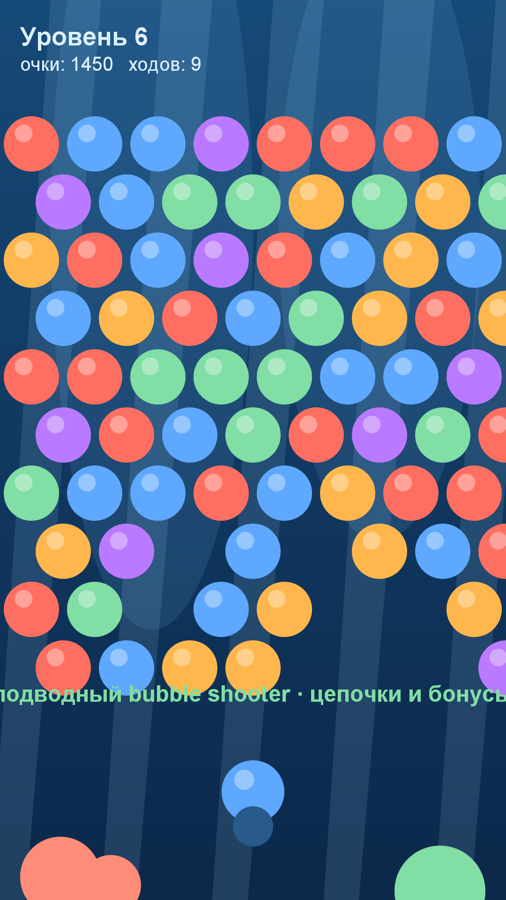

# Игра 17 — «Пузырьки глубин» (Deep Bubbles)

**Жанр:** bubble shooter. **Кор-механика:** стрельба пузырями, цепочки из трёх.
**Платформа:** Android 8.0+ (API 26+). **Стек:** Java 17, Android SDK (Canvas).



## Механика
- Пузырёк вылетает из пушки в выбранную колонку; **3+ соседа одного цвета** — цепочка очищается.
- Незакреплённые пузырьки (не связанные с верхним рядом) **падают** — за них больше очков.
- Комбо-множитель растёт с каждым подряд очищенным выстрелом.
- 30 уровней: число рядов растёт, ходов ограничено; звёзды за остаток ходов.

## Контент: генератор поля с цветовым балансом (ось уникальности C)
Поле генерируется детерминированно по сиду: цвета распределяются по кругу со случайной
перестановкой — каждый цвет гарантированно присутствует (проверяется тестами),
при этом раскладка непредсказуема.

## Управление (Android)
- Тап по экрану — выстрел в колонку; кнопки меню и оверлеев.

## Визуальная подпись

Глубина океана: каустика — диагональные лучи поверхности в толще воды.

Все 20 игр портфолио различаются по трём осям (жанр/механика, визуальный стиль/сеттинг, способ генерации контента); матрица уникальности — в корневом REGISTRY.md.

## Структура проекта
```
game-17-bubble/
├── src/java/com/bubbles/game/  # BubbleBoard (генератор, выстрелы, очистка), BubbleLogic
│                               # (цепочки, падение, скоринг), BubbleView, MainActivity
├── tests/bubbles/              # JUnit-тесты (написаны ДО реализации)
├── assets-gen/ScreenshotGen.java
├── artifacts/
└── screenshot.png
```

## Тесты (10 шт., JUnit 4)
детерминизм; цветовой баланс; установка пузырька; цепочка из трёх очищается; пара — нет;
падение незакреплённых; закреплённые остаются; рост очков от комбо; пустое поле — победа;
рост числа рядов со сложностью.

Запуск:
```powershell
powershell -ExecutionPolicy Bypass -File tools\test-jvm.ps1 -GameDir game-17-bubble
```

## Сборка APK
```powershell
powershell -ExecutionPolicy Bypass -File tools\build-javapk.ps1 -GameDir game-17-bubble
```

## Готовая сборка
APK выкладываются в папку Google Диска портфолио:
https://drive.google.com/drive/folders/1YZzw1tn-sIxi9mlgxwU7H5XNdUKCMvw7?usp=sharing
(подпапка `game-17-bubble/`).
