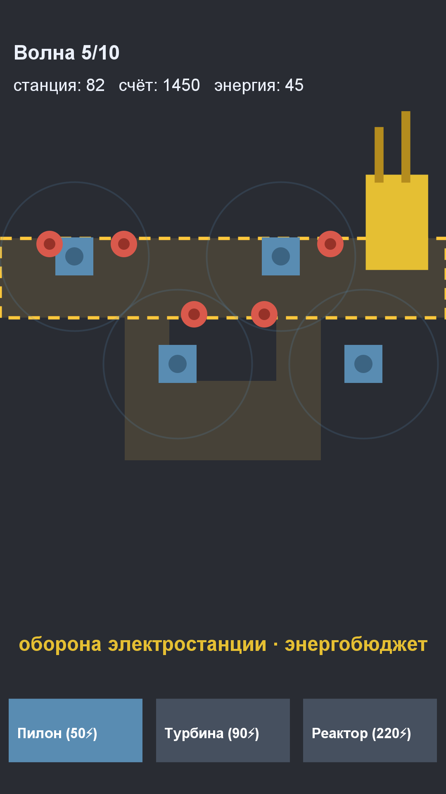

# Игра 18 — «Энерго-Щит» (EnergyShield)

**Жанр:** tower defense. **Кор-механика:** защита электростанции, энергобюджет башен.
**Платформа:** Android 8.0+ (API 26+). **Стек:** Unity 6 (6000.5.6f1), C#.



## Сквозная тема портфолио ★
**Промышленная автоматизация**: защита электростанции от сбоев — башни-контроллеры
(Пилон, Турбина, Конденсатор, Реактор) потребляют энергию самой станции.
Главная механика — **распределение ограниченного энергобюджета** между уровнями защиты.

## Механика
- Враги идут по коридору цеха к электростанции; тап по полю — строительство башни.
- **Каждая башня тратит энергию станции**: сильные башни дороги по энергии — нужен баланс.
- Апгрейды башен: урон ×1.5 за уровень.
- Волны растут в силе; каждая 5-я — босс (один крепкий враг).
- 20 уровней: больше энергии, но и плотнее волны; очки за убийства.

## Контент: планировщик волн + энергобюджет (ось уникальности C)
Волны генерируются детерминированно из сида: суммарная прочность растёт геометрически
(×1.3 за волну), босс-волна концентрирует прочность в одном враге. Тесты гарантируют
монотонный рост силы волн и лимит строительства энергобюджетом.

## Управление (Android)
- Тап по клетке — постройка выбранной башни; кнопки внизу — выбор типа башни.

## Структура проекта
```
game-18-powergrid/
├── src/Assets/Scripts/       # GridCore (WavePlanner, TowerCatalog, DefenseGrid),
│                             # GridGame (сцена, враги, башни, UI)
├── src/Assets/Tests/EditMode # NUnit-тесты (написаны ДО реализации)
├── src/Assets/Editor/        # BuildScript (batchmode-сборка APK)
├── assets-gen/ScreenshotGen.java
├── artifacts/
└── screenshot.png
```

## Тесты (10 шт., NUnit / Unity Test Framework, EditMode)
детерминизм волн; монотонный рост силы; босс на каждой 5-й волне; число волн; характеристики
башен; энергобюджет ограничивает строительство; расход энергии; апгрейд урона; скоринг; занята клетка.

Запуск:
```powershell
powershell -ExecutionPolicy Bypass -File tools\test-unity.ps1 -GameDir game-18-powergrid
```

## Сборка APK
```powershell
powershell -ExecutionPolicy Bypass -File tools\build-unity.ps1 -GameDir game-18-powergrid `
    -AppId com.portfolio.energyshield -ProductName "EnergyShield"
```

## Готовая сборка
APK выкладываются в папку Google Диска портфолио:
https://drive.google.com/drive/folders/1YZzw1tn-sIxi9mlgxwU7H5XNdUKCMvw7?usp=sharing
(подпапка `game-18-powergrid/`).
