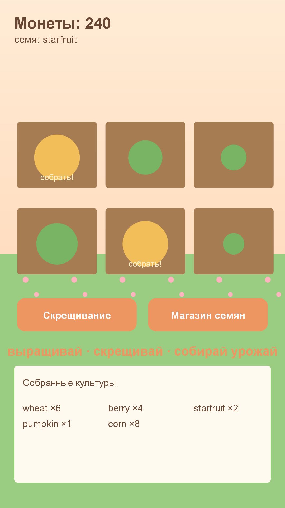

# Игра 19 — «Уютная ферма» (Cozy Farm)

**Жанр:** ферма/менеджмент. **Кор-механика:** выращивание ресурсов, скрещивание культур.
**Платформа:** Android 8.0+ (API 26+). **Стек:** Java 17, Android SDK (Canvas).



## Механика
- 6 грядок: посадка семян, полив (×1.5 к росту), сбор урожая.
- **10 культур** от пшеницы до кристалл-корня: время роста, урожайность, цена и редкость растут.
- **Скрещивание**: две культуры дают новый сорт — результат редко повторяется, но детерминирован.
- Магазин семян, инвентарь, монеты; всё выращенное можно продать.

## Контент: матрица наследования культур (ось уникальности C)
Книга скрещиваний — детерминированная «матрица наследования»: итог зависит от пары
родителей и сида, **симметричен** (AxB = BxA), а редкость результата не ниже редкости
родителей — редкие сорта дают редкие семена. Тесты проверяют все три свойства.

## Управление (Android)
- Тап по грядке — сбор (если созрела) или полив; кнопки «Скрещивание» и «Магазин».

## Структура проекта
```
game-19-farm/
├── src/java/com/farm/game/  # Crop, CropCatalog (10 культур), FarmPlot (рост, полив, сбор),
│                            # BreedingBook (матрица наследования), FarmView, MainActivity
├── tests/farm/              # JUnit-тесты (написаны ДО реализации)
├── assets-gen/ScreenshotGen.java
├── artifacts/
└── screenshot.png
```

## Тесты (10 шт., JUnit 4)
рост культур; созревание; одноразовый сбор; ускорение поливом; детерминированность
скрещивания; известность результата; симметрия матрицы; редкость результата;
корректность характеристик каталога; цена по редкости.

Запуск:
```powershell
powershell -ExecutionPolicy Bypass -File tools\test-jvm.ps1 -GameDir game-19-farm
```

## Сборка APK
```powershell
powershell -ExecutionPolicy Bypass -File tools\build-javapk.ps1 -GameDir game-19-farm
```

## Готовая сборка
APK выкладываются в папку Google Диска портфолио:
https://drive.google.com/drive/folders/1YZzw1tn-sIxi9mlgxwU7H5XNdUKCMvw7?usp=sharing
(подпапка `game-19-farm/`).
