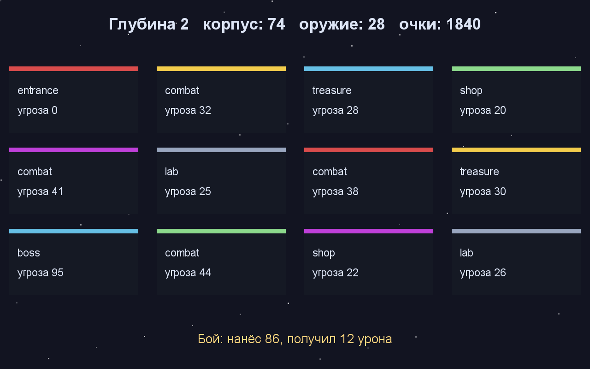

# Игра 20 — «Станция-Падение» (StationFall)

**Жанр:** рогалик-шутер. **Кор-механика:** процедурная генерация, пермадет-забеги.
**Платформа:** Android 8.0+ (API 26+). **Стек:** Godot 4.3 (GDScript).



## Сквозная тема портфолио ★
**Автоматизированная космическая станция** в аварии: игрок исследует процедурно
генерируемую станцию, сражается со сбоями-противниками и добирается до ядра.
Комнаты-типы повторяют узлы АСУ ТП: бой, лаборатория, склад, ремонтная мастерская.

## Механика
- Забег: 5 глубин станции, на каждой — граф комнат (бой, сокровищница, магазин, лаборатория).
- Комната раскрывается тапом: бой (урон зависит от силы и оружия), лут, ремонт, калибровка.
- Между глубинами — прокачка: сила или оружие.
- Корпус тает от боёв; гибель — конец забега, победа — спасение станции. Рекорд сохраняется.

## Контент: генератор графа комнат (ось уникальности C)
Граф комнат генерируется по сиду и глубине: связность гарантируется связями «к следующей
комнате» + случайные перемычки (проверяется BFS-тестами), последняя комната — всегда босс,
сокровищницы несут лут, угроза растёт с глубиной. Бой — детерминированная симуляция.

## Управление (Android)
- Тап по карточке комнаты — вход; тапы на экране прокачки — выбор улучшения.

## Структура проекта
```
game-20-station/
├── src/project.godot, main.tscn, main.gd   # забег, комнаты, бои, прокачка, UI
├── src/logic/dungeon_gen.gd                # чистая логика: граф комнат, бой, прокачка
├── src/tests/                              # headless-тесты (написаны ДО реализации)
├── src/export_presets.cfg, src/icon.png
├── assets-gen/ScreenshotGen.java
├── artifacts/
└── screenshot.png
```

## Тесты (10 шт., headless GDScript)
детерминизм генератора; связность графа; первая комната — вход; последняя — босс;
лут в сокровищницах; рост угрозы с глубиной; детерминированность боя; сильный герой побеждает;
рост цены прокачки; число комнат растёт с глубиной.

Запуск:
```powershell
powershell -ExecutionPolicy Bypass -File tools\test-godot.ps1 -GameDir game-20-station
```

## Сборка APK
```powershell
powershell -ExecutionPolicy Bypass -File tools\build-godot.ps1 -GameDir game-20-station
```
Результат: `artifacts/game-20-station.apk` (~43 МБ).

## Готовая сборка
APK выкладываются в папку Google Диска портфолио:
https://drive.google.com/drive/folders/1YZzw1tn-sIxi9mlgxwU7H5XNdUKCMvw7?usp=sharing
(подпапка `game-20-station/`).
